<picture>
  <source media="(prefers-color-scheme: dark)" srcset="./assets/header-dark.svg">
  <source media="(prefers-color-scheme: light)" srcset="./assets/header-light.svg">
  
</picture>

I build the React and Next.js consoles that security analysts rely on during live attacks, and the Go services that feed them. My focus is real-time, data-heavy interfaces that stay fast and accessible under load.

### What I've built at WiJungle

Closed-source production work

- **Real-time alerting:** replaced 3-second polling with Go WebSockets. Alerts reach analysts in under 45 ms.
- **Performance under load:** a ring buffer, batched renders and a virtualized 120,000-row table took burst render time from 850 ms to 45 ms.
- **Search backend:** Go + Kafka ingestion into Elasticsearch, 360M documents with p95 search under 400 ms.
- **Accessible triage:** keyboard-first alert triage with ARIA live regions, following WCAG 2.2 AA.

### Stack

<picture>
  <source media="(prefers-color-scheme: dark)" srcset="https://skillicons.dev/icons?i=ts%2Cjs%2Creact%2Cnextjs%2Credux%2Cmaterialui%2Cd3%2Cgraphql%2Cgo%2Ckafka%2Celasticsearch%2Cpostgres%2Credis%2Cdocker%2Ckubernetes%2Caws%2Cjest%2Ccypress&perline=9&theme=dark">
  <source media="(prefers-color-scheme: light)" srcset="https://skillicons.dev/icons?i=ts%2Cjs%2Creact%2Cnextjs%2Credux%2Cmaterialui%2Cd3%2Cgraphql%2Cgo%2Ckafka%2Celasticsearch%2Cpostgres%2Credis%2Cdocker%2Ckubernetes%2Caws%2Cjest%2Ccypress&perline=9&theme=light">
  
</picture>

### Projects

| Project | What it is | Stack |
|---|---|---|
| [PathFinder](https://github.com/shreyasheoran/PathFinder) | Grid pathfinding visualizer comparing backtracking DFS and Dijkstra | React · Go |

### Find me

